# 📘 Guia Completo do Sistema, Telas, Regras de Negócio & Endpoints
## 🌆 PROMETHEUS — F.O.G.O. (Fiscalização, Operação, Gestão e Ocorrências)

Este documento é o **Manual Técnico e Operacional** da plataforma PROMETHEUS. Ele apresenta a arquitetura da solução, as regras de negócio implementadas, capturas reais de todas as telas em funcionamento, recortes de componentes e o mapeamento prático de cada endpoint da API RESTful (onde atua na interface, como funciona e qual problema urbano resolve).

---

## 📑 Sumário

1. [Acesso Rápido e Autenticação](#1-acesso-rápido-e-autenticação)
2. [Parte 1 — Inventário Inteligente da Cidade](#2-parte-1--inventário-inteligente-da-cidade)
   - [O Desafio do Inventário Urbano](#o-desafio-do-inventário-urbano)
   - [Listagem de Equipamentos e Filtros](#listagem-de-equipamentos-e-filtros)
   - [Modal de Detalhes Técnicos Rápidos](#modal-de-detalhes-técnicos-rápidos)
   - [Histórico de Manutenções, Custos & Inatividade](#histórico-de-manutenções-custos--inatividade)
   - [Formulário Adaptativo de Cadastro](#formulário-adaptativo-de-cadastro)
   - [Regras de Negócio e Integridade Operacional](#regras-de-negócio-e-integridade-operacional)
   - [Gestão Integrada de Agentes de Campo](#gestão-integrada-de-agentes-de-campo)
   - [Endpoints de Equipamentos e Agentes](#endpoints-de-equipamentos-e-agentes)
3. [Parte 2 — Central de Operações da Cidade (Tempo Real)](#3-parte-2--central-de-operações-da-cidade-tempo-real)
   - [A Pergunta Central: Consciência Situacional ao Vivo](#a-pergunta-central-consciência-situacional-ao-vivo)
   - [Visão Geral da Central de Operações](#visão-geral-da-central-de-operações)
   - [Cards de KPIs Dinâmicos](#cards-de-kpis-dinâmicos)
   - [Mapa Operacional Multi-Camada & Agrupamentos](#mapa-operacional-multi-camada--agrupamentos)
   - [Barra de Filtros Instantâneos](#barra-de-filtros-instantâneos)
   - [Painel de Alertas Críticos & Voo de Câmera](#painel-de-alertas-críticos--voo-de-câmera)
   - [Central Global de Notificações](#central-global-de-notificações)
   - [Saúde Operacional das Regiões](#saúde-operacional-das-regiões)
   - [Endpoints da Central de Operações](#endpoints-da-central-de-operações)
4. [Parte 3 — Cidade Preditiva (Inteligência & Antecipação)](#4-parte-3--cidade-preditiva-inteligência--antecipação)
   - [A Pergunta Central: Enxergar o Amanhã](#a-pergunta-central-enxergar-o-amanhã)
   - [Visão Geral da Central Preditiva](#visão-geral-da-central-preditiva)
   - [Mapa Espacial de Risco por Turno](#mapa-espacial-de-risco-por-turno)
   - [Previsão de Falha de Equipamentos (MTBF)](#previsão-de-falha-de-equipamentos-mtbf)
   - [Explicabilidade da IA (Explainable AI - XAI)](#explicabilidade-da-ia-explainable-ai---xai)
   - [Recomendações Automatizadas de Reforço de Agentes](#recomendações-automatizadas-de-reforço-de-agentes)
   - [Correlação de Falhas em Zonas Compartilhadas](#correlação-de-falhas-em-zonas-compartilhadas)
   - [Projeção Orçamentária de Custos de Manutenção](#projeção-orçamentária-de-custos-de-manutenção)
   - [Fila Ranqueada de Prioridade de Implantação](#fila-ranqueada-de-prioridade-de-implantação)
   - [Endpoints de Inteligência Preditiva](#endpoints-de-inteligência-preditiva)
5. [Documentação Swagger / OpenAPI](#5-documentação-swagger--openapi)
6. [Roteiro de Validação e Testes Automatizados (43 Testes)](#6-roteiro-de-validação-e-testes-automatizados-43-testes)
7. [Postman Collection Automatizada da API](#7-postman-collection-automatizada-da-api)

---

## 1. Acesso Rápido e Autenticação

### Tela de Autenticação (`/login`)

A porta de entrada do sistema adota identidade visual Cyber Dark com transparências em Glassmorphism. A camada de segurança opera via tokens JWT (JSON Web Token) assinados com algoritmo HMAC-SHA256 e senhas protegidas com criptografia forte (Bcrypt).


*Figura 1.1: Tela de login com preenchimento facilitado das credenciais de teste.*

#### Recorte do Componente de Login:
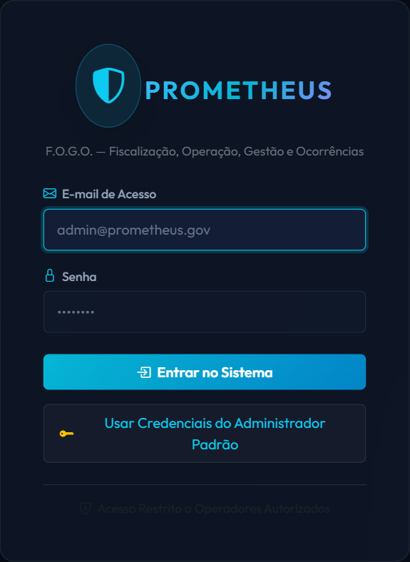

*Figura 1.2: Card de login com atalho rápido "Usar Credenciais do Administrador Padrão".*

### Credenciais Padrão do Sistema:
* **URL:** `http://localhost:8000/login`
* **Usuário:** `admin@prometheus.gov`
* **Senha:** `admin123`
* **Perfil:** Administrador (Acesso total às operações de gestão, edição, exclusão lógica e calibração de modelos).

### Endpoints de Autenticação:
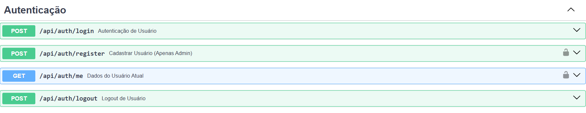

*Figura 1.3: Grupo de endpoints de autenticação e sessão no Swagger.*

| Método | Endpoint | Onde atua na tela | Como funciona | Para que serve / O que resolve |
| :--- | :--- | :--- | :--- | :--- |
| `POST` | `/api/auth/login` | Botão **"Entrar no Sistema"** na tela `/login` | Recebe `email` e `senha` em JSON, valida o hash bcrypt no banco SQLite e retorna o token JWT com tempo de expiração | Autentica o operador/gestor e inicia a sessão segura no navegador |
| `POST` | `/api/auth/register` | Formulário de gestão de usuários (Admin) | Recebe nome, email, senha e tipo de permissão (`admin` ou `operador`). Valida unicidade de email | Permite cadastrar novos operadores sem compartilhar senhas |
| `GET` | `/api/auth/me` | Topo direito da Navbar (Badge do Usuário) | Lê o token JWT presente no cookie ou header `Authorization: Bearer <token>` e retorna os dados do usuário autenticado | Exibe o nome e perfil do operador logado e valida permissões de acesso |
| `POST` | `/api/auth/logout` | Botão **"Sair"** no topo da Navbar | Invalida o token JWT no cliente e redireciona para `/login` | Encerra a sessão com segurança ao final do plantão |

---

## 2. Parte 1 — Inventário Inteligente da Cidade

### O Desafio do Inventário Urbano
Antes de qualquer monitoramento ou previsão, a cidade precisa saber exatamente quais recursos possui e onde estão instalados. Como catalogar dezenas de equipamentos com naturezas tão diferentes — radares de velocidade com faixas e velocidade máxima, câmeras com visão noturna e PTZ, totens de estacionamento rotativo, patinetes elétricos, cancelas e viaturas de segurança — sem perder a flexibilidade técnica nem a padronização dos dados?

**Como o PROMETHEUS resolve esse problema:**  
A solução constrói um modelo híbrido relacional e flexível: dados essenciais (número de série, fabricante, modelo, endereço com ponto de referência, coordenadas GPS e situação operacional) ficam em colunas estruturadas, enquanto características exclusivas de cada tecnologia são armazenadas dinamicamente em formato JSON/EAV.

---

### Listagem de Equipamentos e Filtros (`/admin/equipamentos`)

Apresenta a listagem completa de equipamentos urbanos de apoio ao trânsito e à segurança.

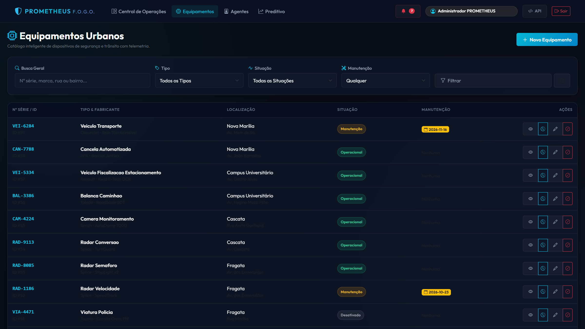

*Figura 2.1: Painel do Inventário de Equipamentos com filtros combinados e tabela de ativos.*

#### Recorte da Tabela e Ações:
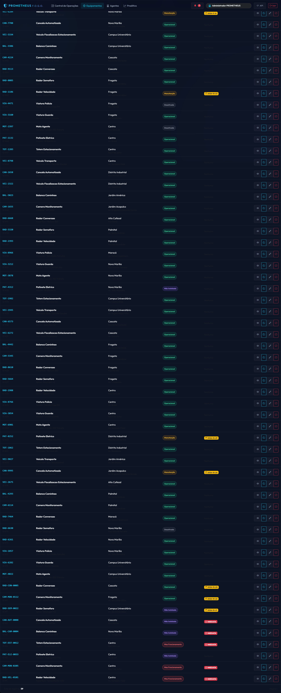

*Figura 2.2: Tabela com identificação visual por badges, tipo de equipamento, endereço com referência e botões de ação: Detalhes (<i class="bi bi-eye"></i>), Histórico (<i class="bi bi-clock-history"></i>), Editar (<i class="bi bi-pencil"></i>) e Desativação Lógica (<i class="bi bi-slash-circle"></i>).*

* **O que resolve:** Permite ao gestor localizar instantaneamente qualquer ativo pelo número de série, fabricante, rua ou bairro, aplicando múltiplos filtros combinados (tipo, situação e manutenção) sem recarregar a tela.

---

### Modal de Detalhes Técnicos Rápidos

Ao clicar no botão de inspeção (<i class="bi bi-eye"></i>), o sistema abre instantaneamente um modal sem recarregar a tela, exibindo as coordenadas geográficas precisas, dados de instalação e as **propriedades dinâmicas formatadas** do equipamento.

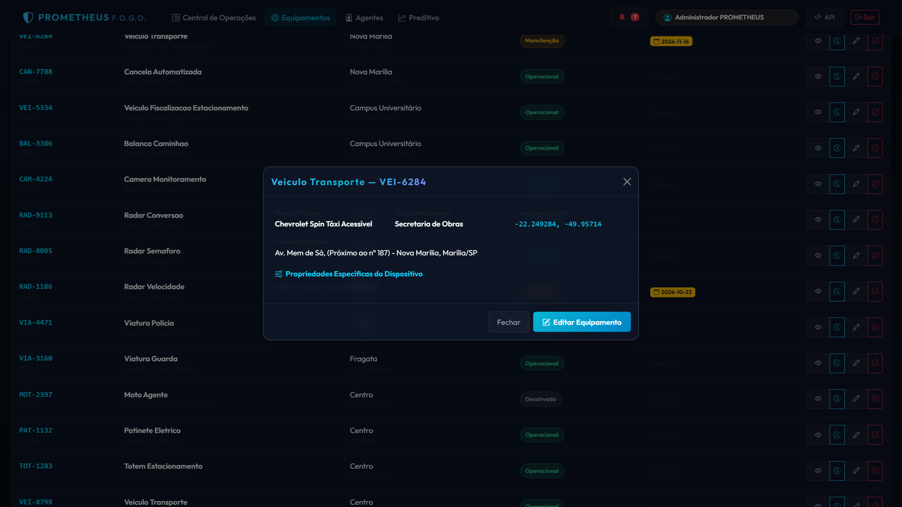

*Figura 2.3: Modal de visualização técnica de equipamento com propriedades dinâmicas.*

* **O que resolve:** Fornece acesso imediato a especificações particulares (resolução de câmera, visão noturna, velocidade máxima fiscalizada, quantidade de faixas) para técnicos em campo sem poluir a tabela geral.

---

### Histórico de Manutenções, Custos & Inatividade

Manter a cidade funcionando exige acompanhar de perto o ciclo de vida dos aparelhos. O sistema integra um painel de histórico de intervenções com indicadores de inatividade e custos financeiros acumulados.

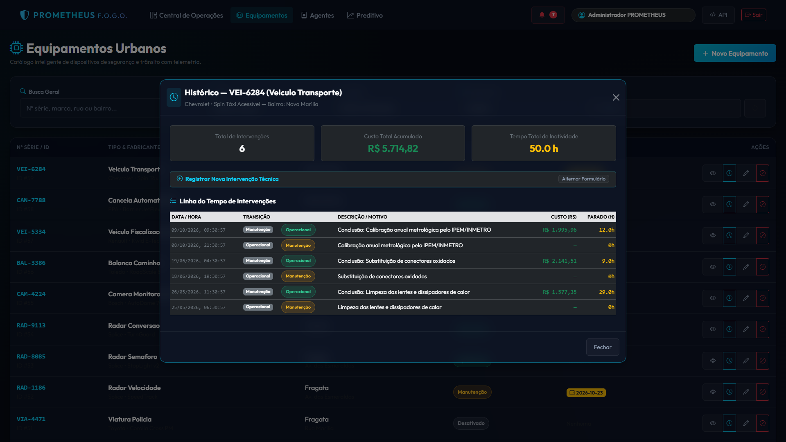

*Figura 2.4: Modal com KPIs de intervenções (Total, Custo Acumulado em R$ e Horas Parado), formulário retrátil para registrar novas manutenções e timeline de transições de status.*

* **O que resolve:** Evita a falta de rastreabilidade de gastos e paralisações. O gestor visualiza exatamente quantas vezes um equipamento quebrou, quanto custou aos cofres públicos e quantas horas ficou inoperante (*downtime*), além de permitir o registro ágil de novos chamados técnicos.

---

### Formulário Adaptativo de Cadastro (`/admin/equipamentos/novo`)

O formulário adota o padrão **Dynamic Form Adaptation**: conforme o operador escolhe o tipo de equipamento, os campos técnicos correspondentes surgem automaticamente na interface.

#### 1. Cadastro de Radar de Velocidade:
Solicita automaticamente velocidade máxima da via e quantidade de faixas fiscalizadas.
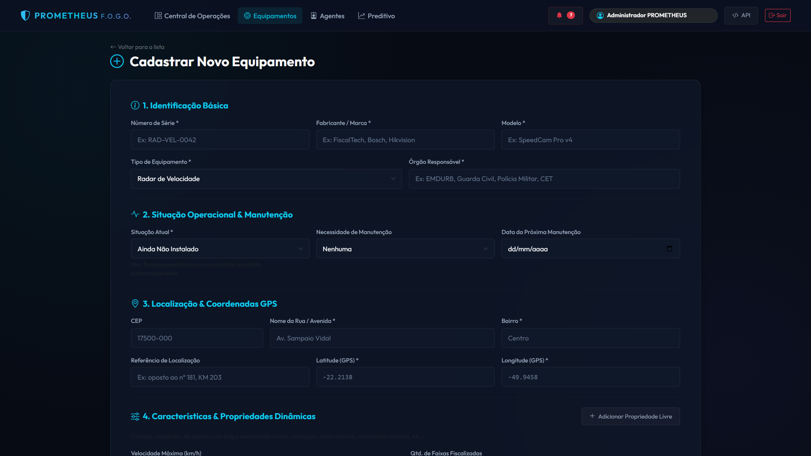

*Figura 2.5: Formulário exibindo campos específicos para radares de trânsito.*

#### 2. Cadastro de Câmera de Videomonitoramento:
Injeta dinamicamente campos de visão noturna infravermelha, suporte a PTZ (Pan-Tilt-Zoom) e resolução de captura (ex: 4K, Full HD).
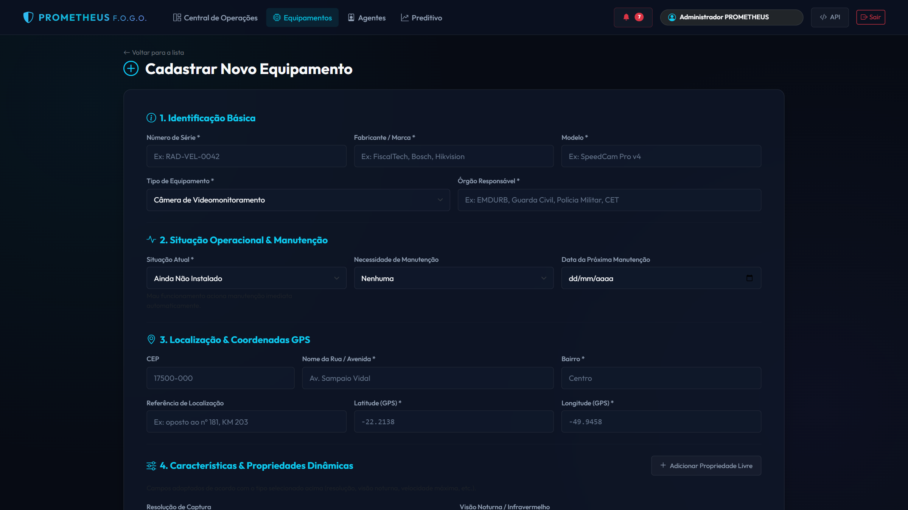

*Figura 2.6: Formulário adaptando campos para câmeras de segurança.*

* **O que resolve:** Elimina formulários genéricos confusos ou cheios de campos vazios irrelevantes, garantindo que cada equipamento seja cadastrado com seus dados técnicos exatos.

---

### Regras de Negócio e Integridade Operacional

#### 1. Acionamento Automático de Manutenção Imediata
Quando um equipamento apresenta mau funcionamento ou pane nas ruas, o processo de abertura de chamado não pode depender de intervenção manual demorada. No momento em que a situação **"Mau Funcionamento"** é selecionada, o sistema altera automaticamente a necessidade de manutenção para **"Imediata"** e exibe um alerta visual informando a urgência do reparo.

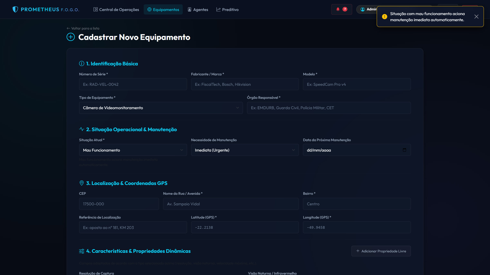

*Figura 2.7: Gatilho automático mudando manutenção para Imediata ao selecionar Mau Funcionamento.*

#### 2. Bloqueio de Retorno de Ativos Furtados ou Desativados
Dispositivos marcados como `furtado` ou `desativado` não podem retornar diretamente para o status `operacional`. O sistema exige confirmação expressa de vistoria técnica e laudo pericial para garantir que aparelhos sinistrados ou vandalizados não retornem ao mapa sem validação presencial.

#### 3. Desativação Segura (*Soft Delete*)
Equipamentos desativados não são apagados fisicamente do banco de dados relacional. O sistema altera o status `ativo = False` e a situação para `desativado`, preservando 100% do histórico de telemetria, custos acumulados e registros de auditoria.

---

### Gestão Integrada de Agentes de Campo (`/admin/agentes`)

O sistema integra os profissionais que atuam diretamente nas vias — agentes de trânsito da autoridade municipal (EMDURB), guardas civis municipais e policiais militares — permitindo que o centro de comando visualize as equipes em campo e suas disponibilidades.

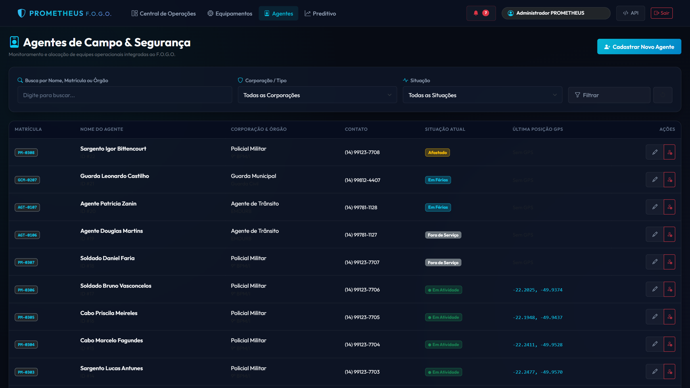

*Figura 2.8: Módulo de gestão de agentes de campo com filtros por órgão e situação operacional.*

#### Formulário de Agente (`/admin/agentes/novo`):
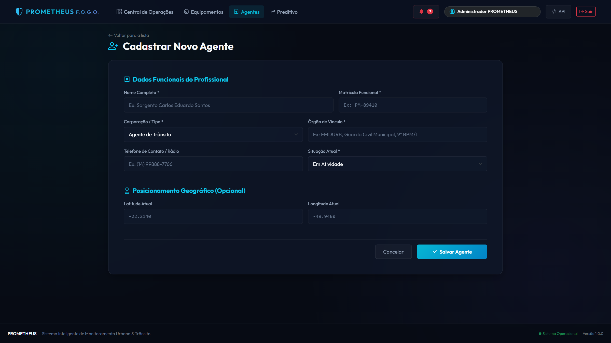

*Figura 2.9: Tela de cadastro e alocação de equipes operacionais urbanas.*

* **O que resolve:** Conecta a gestão de equipamentos físicos com as forças humanas operacionais, viabilizando o despacho coordenado de equipes para ocorrências e manutenções.

---

### Endpoints de Equipamentos e Agentes

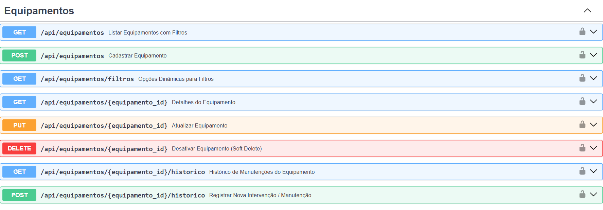

*Figura 2.10: Endpoints da API REST para equipamentos e histórico.*

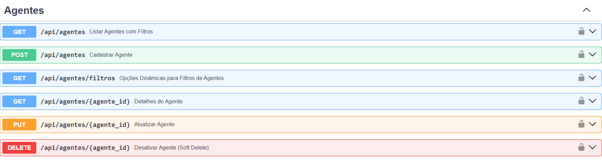

*Figura 2.11: Endpoints da API REST para agentes de campo.*

| Método | Endpoint | Onde atua na tela | Como funciona | Para que serve / O que resolve |
| :--- | :--- | :--- | :--- | :--- |
| `GET` | `/api/equipamentos/` | Listagem `/admin/equipamentos` | Suporta parâmetros de busca textual (`q`), filtro por `tipo`, `situacao`, `manutencao` e paginação | Alimenta a tabela dinâmica de ativos da cidade |
| `POST` | `/api/equipamentos/` | Formulário `/admin/equipamentos/novo` | Valida schema Pydantic, normaliza coordenadas GPS e persiste dados básicos + propriedades dinâmicas | Cadastra novo equipamento no inventário municipal |
| `GET` | `/api/equipamentos/{id}` | Modal de Detalhes Rápidos | Busca o equipamento por ID com todas as propriedades chave-valor relacionadas | Exibe detalhes técnicos sem recarregar a tela |
| `PUT` | `/api/equipamentos/{id}` | Edição `/admin/equipamentos/{id}/editar` | Executa validações de transição de estado e atualiza os dados cadastrais | Atualiza status operacional e parâmetros técnicos |
| `DELETE` | `/api/equipamentos/{id}` | Botão Desativar na listagem | Realiza exclusão lógica (*soft delete*) alterando `ativo = False` | Desativa o equipamento sem quebrar o histórico |
| `GET` | `/api/equipamentos/{id}/historico` | Modal de Histórico | Retorna lista ordenada cronologicamente de manutenções, motivos, tempo parado e custos em R$ | Alimenta a timeline de intervenções do equipamento |
| `POST` | `/api/equipamentos/{id}/historico` | Formulário de Nova Intervenção no Modal | Registra uma nova intervenção com custo e horas paradas, atualizando a situação do equipamento | Salva manutenções preventivas ou corretivas executadas |
| `GET` | `/api/agentes/` | Listagem `/admin/agentes` | Filtra por corporação (`agente_transito`, `guarda_municipal`, `policial_militar`) e situação | Alimenta a tabela de agentes em campo |
| `POST` | `/api/agentes/` | Formulário `/admin/agentes/novo` | Valida unicidade de matrícula e persiste cadastro de agente | Cadastra novo agente policial, guarda ou de trânsito |
| `PUT` | `/api/agentes/{id}` | Formulário de Edição de Agente | Atualiza situação de turno, escala, viatura ou coordenadas | Mantém o status do efetivo atualizado |

---

## 3. Parte 2 — Central de Operações da Cidade (Tempo Real)

### A Pergunta Central: Consciência Situacional ao Vivo
> *"Se algo estiver acontecendo na cidade agora, PROMETHEUS conseguirá perceber?"*

Para que uma central de comando urbano tome decisões assertivas, dados cadastrais estáticos não bastam: é preciso transformá-los em **consciência situacional em tempo real**.

**Como a Central de Operações responde SIM a essa pergunta:**  
O PROMETHEUS conecta mapa operacional com telemetria contínua, indicadores instantâneos de disponibilidade, agrupamentos inteligentes para evitar poluição visual, alertas críticos com aproximação de câmera (*FlyTo*) e monitoramento da saúde por bairros. Se um semáforo quebrar, um radar parar de registrar passagem, uma câmera for desconectada ou um bairro sofrer um apagão, a Central de Operações identifica, destaca e orienta a intervenção em segundos.

---

### Visão Geral da Central de Operações (`/admin/dashboard`)

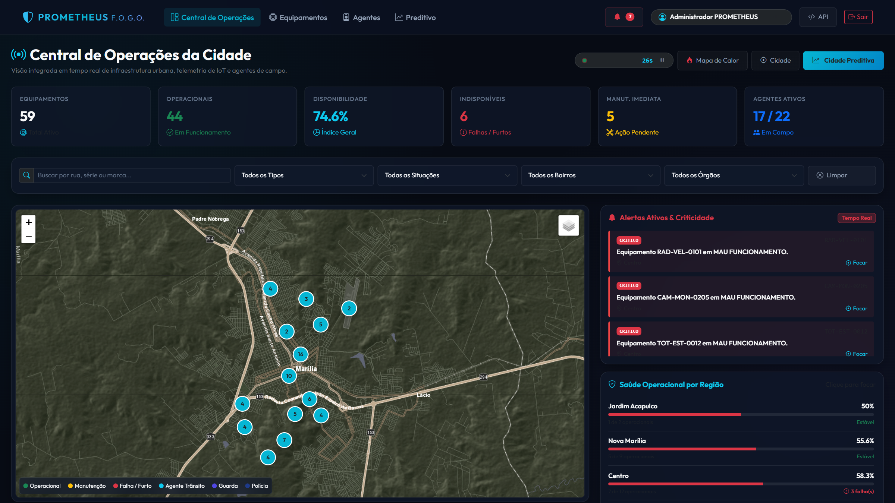

*Figura 3.1: Visão panorâmica da Central de Operações: KPIs de alto nível, mapa interativo, alertas priorizados e saúde dos bairros.*

---

### Cards de KPIs Dinâmicos

Localizados no topo do painel, fornecem uma síntese executiva em tempo real:


*Figura 3.2: 6 cards de KPIs dinâmicos da operação urbana.*

1. **Equipamentos (59):** Total de dispositivos ativos no inventário.
2. **Operacionais (44):** Dispositivos funcionando em perfeito estado.
3. **Disponibilidade (74.6%):** Índice de disponibilidade calculada pela fórmula: $\frac{\text{Operacionais}}{\text{Total Ativos}} \times 100$.
4. **Indisponíveis (6):** Total de ativos em falha, manutenção ou furto.
5. **Manutenção Imediata (5):** Equipamentos exigindo intervenção urgente em campo.
6. **Agentes Ativos (17/22):** Efetivo de trânsito, guarda e polícia em patrulha.

* **O que resolve:** Permite ao secretário ou gestor de plantão avaliar a saúde operacional da cidade inteira em 3 segundos, sem precisar abrir relatórios ou navegar por tabelas.

---

### Mapa Operacional Multi-Camada & Agrupamentos

O mapa interativo utiliza a biblioteca Leaflet de forma 100% gratuita, sem necessidade de chaves de API pagas.

#### 1. Visão Geral da Cidade (Escala Macro com Clusters):
Ao afastar o zoom para enxergar o município como um todo, equipamentos e equipes próximas se agrupam dinamicamente em círculos cianos informando a contagem de dispositivos em cada setor, evitando sobreposição e poluição visual:

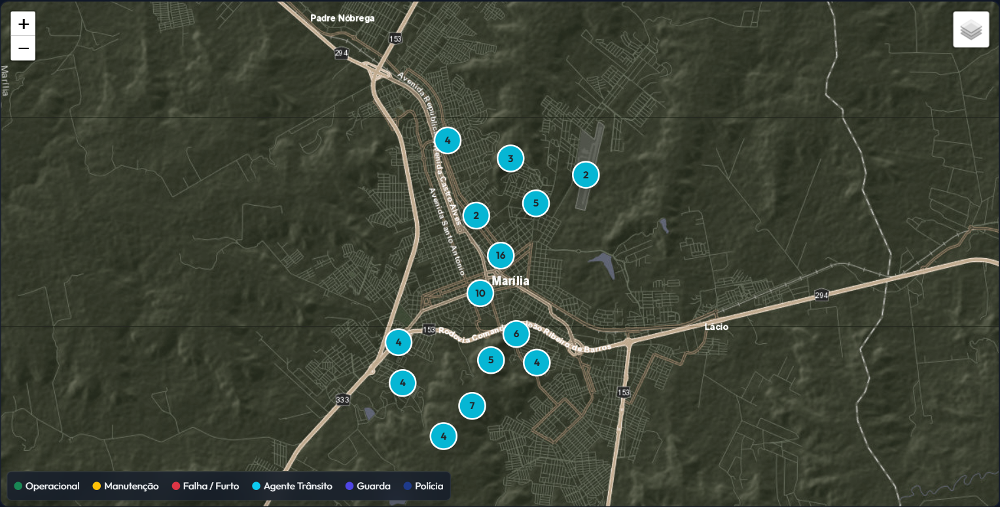

*Figura 3.3a: Mapa na visão geral da cidade com agrupamento inteligente de marcadores (clusters cianos com contagem).*

#### 2. Visão de Rua / Zoom 16+ (Desagrupamento Automático):
Conforme o operador aproxima a visualização para o nível de quarteirão ou rua (zoom 16 ou superior), a regra `disableClusteringAtZoom: 16` é acionada: **o cluster se desmembra sozinho**, revelando a posição exata de cada radar, câmera, totem, patinete e agente em patrulha. Ao clicar no equipamento ou voar até o local, abre-se o balão informativo (*popup*) com atalhos para edição e histórico:

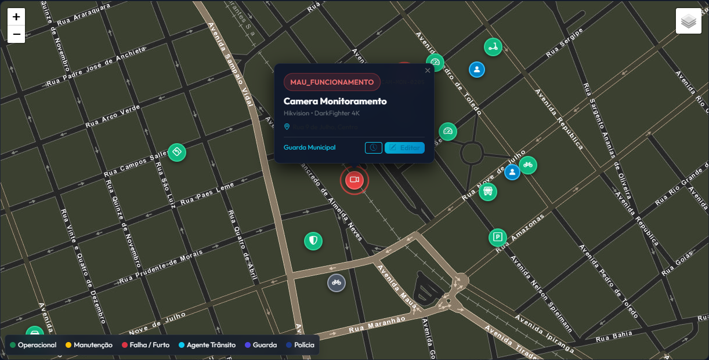

*Figura 3.3b: Visão aproximada no nível de rua (zoom 17) no Centro: o agrupamento é removido, exibindo ícones SVG específicos por tipo (câmera, radar, viatura, totem) e o popup de detalhes técnicos aberto.*

* **Camadas Disponíveis:** Cyber Dark (CartoDB Dark), Satélite Real (Esri World Imagery) e Mapa Urbano (OpenStreetMap).
* **Ícones Especializados com Halo Pulsante:** Cada tipo possui um ícone SVG exclusivo (radar, semáforo, câmera, totem, viatura). Dispositivos em situação crítica (como a câmera de monitoramento em mau funcionamento na Figura 3.3b) pulsam com anel luminoso vermelho.
* **Mapa de Calor (*Heatmap*):** Botão "Mapa de Calor" no topo liga/desliga a visualização térmica de densidade de incidentes urbanos.
* **O que resolve:** Elimina a confusão visual de dezenas de marcadores empilhados na tela e, ao mesmo tempo, permite uma inspeção minuciosa quarteirão por quarteirão ao aproximar a câmera.

---

### Barra de Filtros Instantâneos

Permite combinar filtros sem recarregar a página (*live update*):


*Figura 3.4: Barra de filtros instantâneos por texto, tipo de equipamento, situação, bairro e órgão.*

* **O que resolve:** Facilita operações especializadas (por exemplo: um coordenador de trânsito pode isolar apenas *Radares de Velocidade* com *Mau Funcionamento* no *Centro* em um clique).

---

### Painel de Alertas Críticos & Voo de Câmera

No painel lateral direito, incidentes que exigem atenção imediata são priorizados por nível de criticidade:

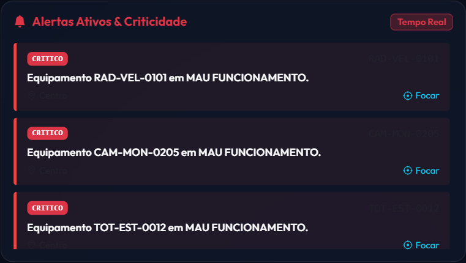

*Figura 3.5: Alertas ordenados por urgência com botão de ação rápida "Focar".*

* **Ação "Focar" (*FlyTo*):** Ao clicar em qualquer alerta (ou no botão "Focar"), a câmera do mapa faz uma animação de voo suave (*smooth fly*) até as coordenadas do equipamento no zoom 17 e abre automaticamente o popup informativo com as ações de edição e histórico.
* **O que resolve:** Acaba com a perda de tempo na localização de ocorrências. O operador não precisa procurar o equipamento quebrado no mapa; a interface o leva diretamente ao ponto crítico.

---

### Central Global de Notificações

Presente na barra de navegação superior, o sino (<i class="bi bi-bell-fill"></i>) mantém a contagem de incidentes críticos atualizada em qualquer página do sistema:

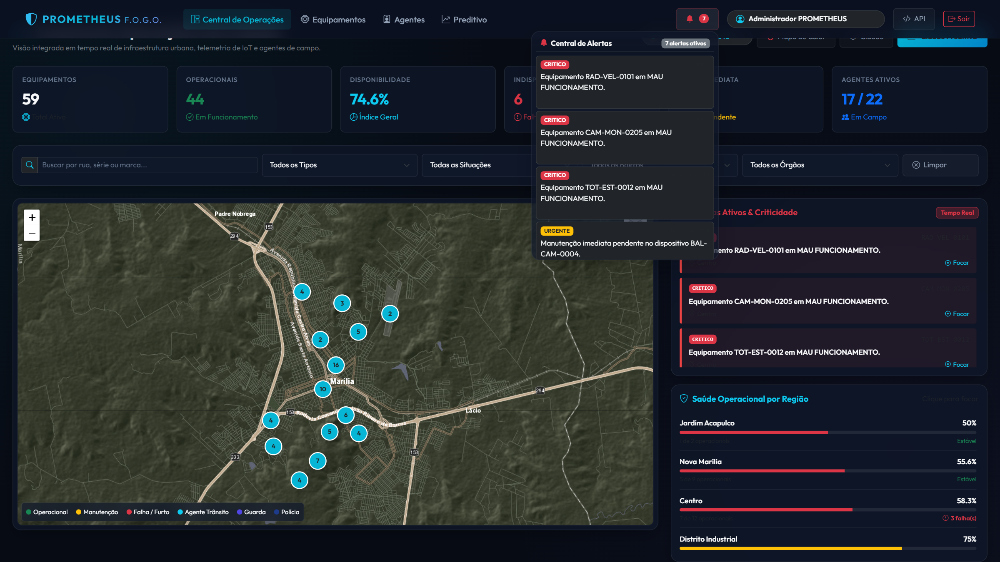

*Figura 3.6: Dropdown de notificações acessível em todas as telas com redirecionamento inteligente.*

* **O que resolve:** Garante que mesmo se o gestor estiver cadastrando um equipamento ou conferindo uma listagem, ele seja notificado de falhas críticas que ocorram no mesmo instante.

---

### Saúde Operacional das Regiões

Apresenta a taxa de disponibilidade segmentada por bairros:

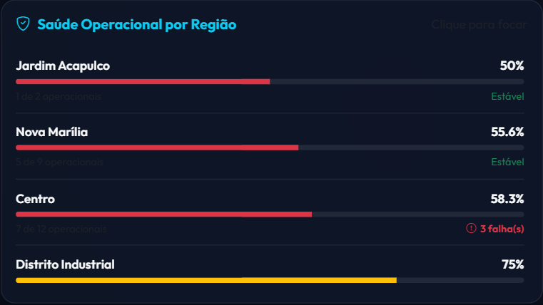

*Figura 3.7: Ranking de saúde por região com barra de progresso colorida e filtro por 1 clique.*

* **Interação por 1 Clique:** Clicar em um bairro (ex: *Centro* ou *Fragata*) move o mapa automaticamente para o bairro e filtra instantaneamente os ativos locais.
* **O que resolve:** Evita a distribuição desigual de suporte técnico, identificando claramente quais bairros estão operando normalmente (>90%) e quais estão com a infraestrutura comprometida.

---

### Endpoints da Central de Operações

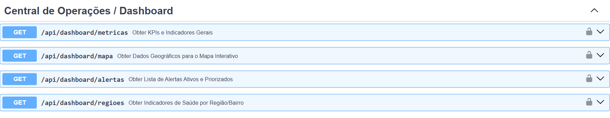

*Figura 3.8: Endpoints da Central de Operações no Swagger.*

| Método | Endpoint | Onde atua na tela | Como funciona | Para que serve / O que resolve |
| :--- | :--- | :--- | :--- | :--- |
| `GET` | `/api/dashboard/metricas` | 6 Cards de KPIs no topo do dashboard | Executa queries agregadas SQL calculando totais de operacionais, taxa de disponibilidade e agentes | Fornece os indicadores gerais de saúde da cidade em tempo real |
| `GET` | `/api/dashboard/mapa` | Mapa Leaflet (marcadores e clusters) | Retorna a lista georreferenciada de equipamentos e agentes com situação, tipo, latitude e longitude | Renderiza os pontos no mapa e alimenta a camada térmica (heatmap) |
| `GET` | `/api/dashboard/alertas` | Painel lateral direito e sino da navbar | Busca equipamentos com falhas, furtos ou manutenção urgente, classificando por criticidade | Alimenta os alertas priorizados da central |
| `GET` | `/api/dashboard/regioes` | Card "Saúde Operacional por Região" | Agrupa equipamentos por bairro e calcula o percentual de ativos operacionais em cada região | Revela assimetrias de disponibilidade entre diferentes bairros |

---

## 4. Parte 3 — Cidade Preditiva (Inteligência & Antecipação)

### A Pergunta Central: Enxergar o Amanhã
> *"PROMETHEUS já consegue enxergar o que está acontecendo na cidade agora. Mas você consegue fazê-lo enxergar o que pode acontecer amanhã?"*

Reagir a acidentes de trânsito, semáforos apagados e crimes apenas depois que eles acontecem sobrecarrega as equipes de emergência, gera congestionamentos e eleva os custos de reparo. 

**Como a Cidade Preditiva resolve esse desafio:**  
O PROMETHEUS cruza mais de 6 meses de telemetria histórica e centenas de eventos registrados para identificar padrões e calcular riscos futuros através de 6 algoritmos estatísticos práticos e explicáveis.

---

### Visão Geral da Central Preditiva (`/admin/preditivo`)

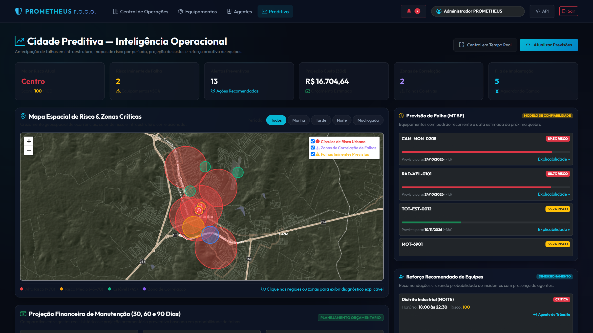

*Figura 4.1: Visão panorâmica do painel de inteligência preditiva: mapa espacial de risco, previsão de falhas MTBF, reforço de agentes, projeção de custos e fila de implantação.*

#### Recorte dos KPIs Executivos Preditivos:


*Figura 4.2: Indicadores preditivos: bairro com maior risco atual (Centro - 100/100), falhas iminentes (2), alertas preventivos (13), projeção financeira para 30 dias (R$ 16.704,64), zonas de correlação (2) e fila de implantação (5).*

---

### Mapa Espacial de Risco por Turno

O tráfego e a segurança urbana não se comportam da mesma maneira às 8h da manhã e às 2h da madrugada. Tratar os bairros de forma estática gera desperdício de equipes em locais calmos e desassistência onde o risco se concentra.

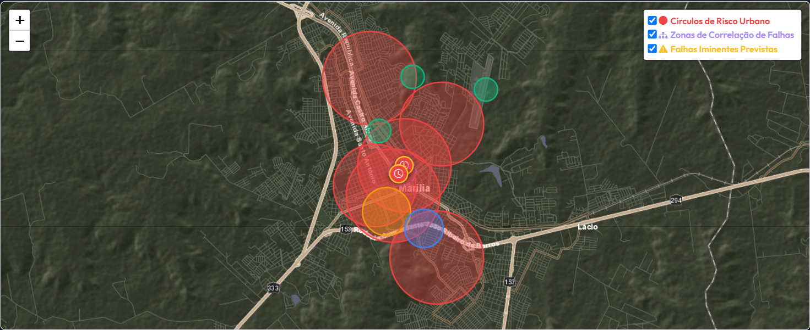

*Figura 4.3: Mapa com círculos de risco ponderados por período e zonas pontilhadas de correlação.*

* **Segmentação Temporal:** Abas interativas permitem alternar entre **Todos**, **Manhã**, **Tarde**, **Noite** e **Madrugada**.
* **Cálculo do Score de Risco:** Cada região recebe um índice de 0 a 100 ponderando o volume de colisões, lentidão, quebras de semáforos e crimes registrados naquele turno específico. Círculos vermelhos indicam alto risco (>70), amarelos médio risco (45-70) e verdes estabilidade (<45).
* **O que resolve:** Demonstra visualmente aos secretários de segurança e mobilidade onde posicionar viaturas antes que o turno crítico comece.

---

### Previsão de Falha de Equipamentos (MTBF)

Trocar componentes eletrônicos apenas após a quebra deixa cruzamentos desprotegidos e eleva o risco de acidentes. O modelo de confiabilidade **MTBF (*Mean Time Between Failures*)** calcula o ciclo de vida útil de cada equipamento:

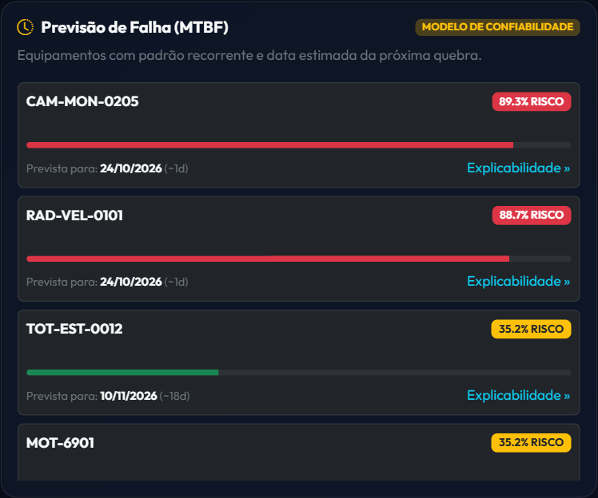

*Figura 4.4: Equipamentos em risco crítico com MTBF calculado em dias, probabilidade de avaria e data estimada da falha.*

$$\text{MTBF} = \frac{\text{Tempo Total de Operação}}{\text{Número de Falhas Registradas}}$$

$$\text{Probabilidade de Quebra (\%)} = \min\left(95\%, \left(\frac{\text{Dias desde a Última Falha}}{\text{MTBF}}\right) \times 100\right)$$

* **O que resolve:** Permite que a equipe de manutenção atue preventivamente substituindo peças desgastadas antes que o equipamento pare nas ruas.

---

### Explicabilidade da IA (Explainable AI - XAI)

Gestores públicos e engenheiros de tráfego não podem tomar decisões com base em algoritmos de "caixa preta" sem justificativa clara. Ao clicar em **"Explicabilidade &raquo;"** em qualquer previsão, o sistema abre o modal de transparência analítica:

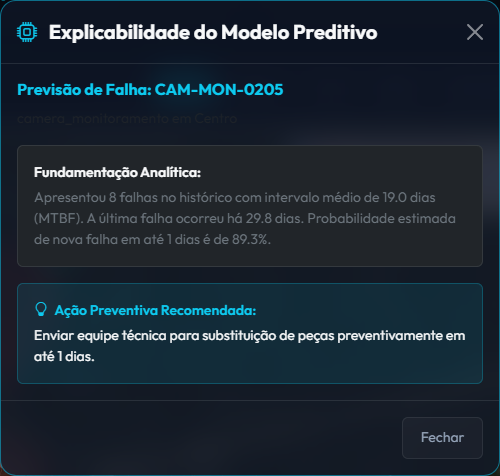

*Figura 4.5: Modal de Explainable AI (XAI) detalhando as variáveis históricas consideradas e recomendando a ação corretiva.*

* **Fundamentação Analítica:** Apresenta a quantidade de falhas passadas, o MTBF exato em dias e o tempo transcorrido desde a última intervenção.
* **Ação Preventiva Recomendada:** Orienta o gestor sobre o procedimento operacional correto (ex: *"Enviar equipe técnica para substituição preventiva de peças em até 1 dia"*).
* **O que resolve:** Garante segurança jurídica, técnica e administrativa às tomadas de decisão da prefeitura.

---

### Recomendações Automatizadas de Reforço de Agentes

Escalas de serviço costumam ser montadas de forma burocrática e engessada. O sistema cruza o risco do bairro no turno com o efetivo em patrulha para calcular o dimensionamento ideal:

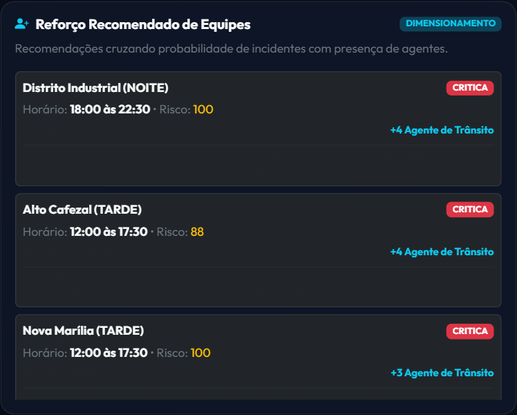

*Figura 4.6: Recomendações com cálculo de déficit de agentes e especialidade requerida.*

* **Déficit e Especialidade Inteligente:** Se o risco predominante for de congestionamento ou colisões, recomenda **Agentes de Trânsito**. Se o padrão for de furto, roubo ou vandalismo noturno, recomenda **Guardas Municipais** ou **Polícia Militar**.
* **O que resolve:** Elimina o desperdício de efetivo e garante que a corporação com a competência adequada esteja no local certo no momento oportuno.

---

### Correlação de Falhas em Zonas Compartilhadas

Quando múltiplos equipamentos caem na mesma avenida, o procedimento comum é abrir ordens de serviço isoladas para cada um, sem notar que o problema real pode ser uma árvore caída na rede elétrica ou um rompimento de fibra óptica.

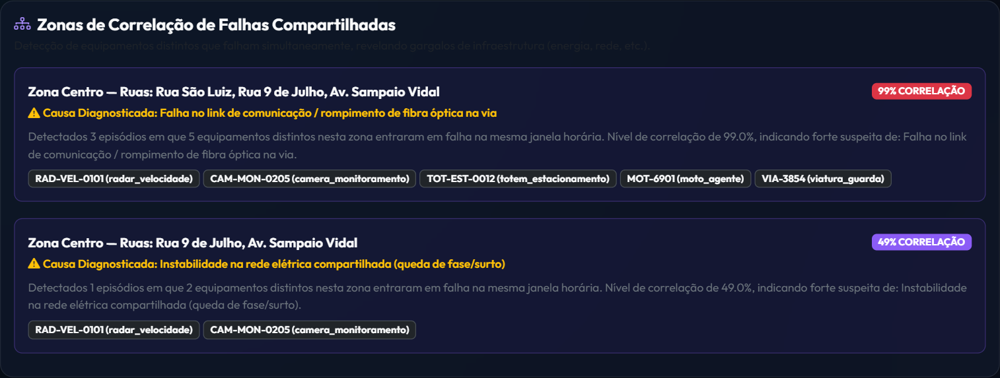

*Figura 4.7: Diagnóstico de incidentes coletivos causados por infraestrutura compartilhada.*

* **Diagnóstico de Causa Raiz:** Agrupa falhas simultâneas em raio de proximidade e alerta para causa compartilhada (*"Queda de fase de energia elétrica na avenida"*, *"Rompimento de anel de fibra óptica"* ou *"Vandalismo coordenado"*).
* **O que resolve:** Evita o envio de múltiplos técnicos avulsos e orienta o acionamento direto da concessionária de energia ou operadora de telecomunicações.

---

### Projeção Orçamentária de Custos de Manutenção

Reparos de emergência custam mais caro e geram surpresas nas contas públicas. A plataforma projeta os custos de manutenção preventiva e corretiva para 30, 60 e 90 dias, acompanhados de gráfico comparativo interativo em **Chart.js**:

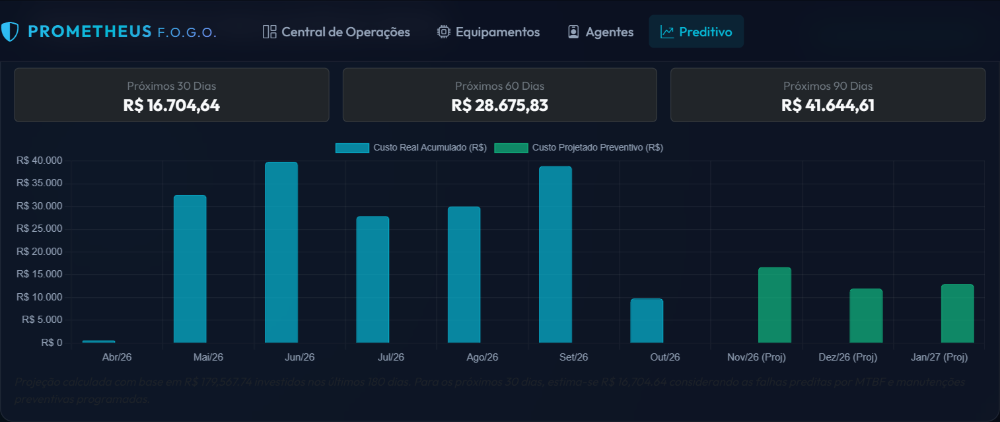

*Figura 4.8: Gráfico de barras comparando gastos reais passados com a projeção financeira futura.*

* **O que resolve:** Permite que a Secretaria de Finanças e de Trânsito provisione recursos com antecedência, reduzindo despesas com contratações de emergência.

---

### Fila Ranqueada de Prioridade de Implantação

Quando novos equipamentos chegam ao depósito municipal aguardando instalação nas ruas, qual cruzamento deve ser atendido primeiro?

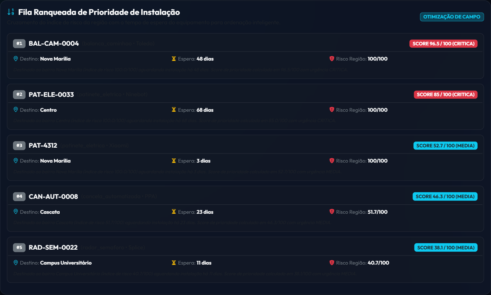

*Figura 4.9: Tabela ordenada com score de urgência de instalação.*

$$\text{Score de Urgência} = (0.60 \times \text{Score de Risco do Bairro}) + (0.40 \times \text{Dias de Espera Normalizados})$$

* **O que resolve:** Elimina critérios subjetivos ou políticos na escolha dos locais de instalação, direcionando os equipamentos novos primeiro para as vias onde o risco de acidentes e ocorrências é comprovadamente maior.

---

### Endpoints de Inteligência Preditiva

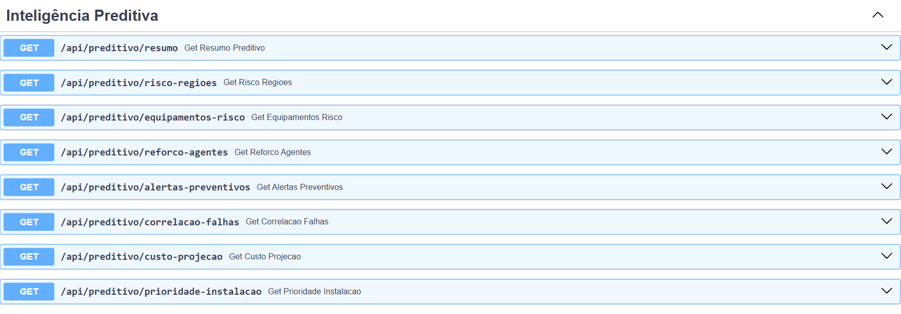

*Figura 4.10: Endpoints da API REST para o módulo preditivo.*

| Método | Endpoint | Onde atua na tela | Como funciona | Para que serve / O que resolve |
| :--- | :--- | :--- | :--- | :--- |
| `GET` | `/api/preditivo/resumo` | 6 Cards de KPIs Executivos do Preditivo | Processa indicadores agregados de maior risco atual, custo projetado e falhas iminentes | Fornece visão executiva da inteligência preditiva |
| `GET` | `/api/preditivo/risco-regioes` | Mapa Espacial de Risco e abas de Turnos | Aceita o parâmetro opcional `periodo` (`manha`, `tarde`, `noite`, `madrugada` ou `todos`). Retorna coordenadas, score e explicação de cada bairro | Alimenta os círculos de risco ponderados no mapa |
| `GET` | `/api/preditivo/equipamentos-risco` | Card "Previsão de Falha (MTBF)" e modal XAI | Calcula o MTBF em dias e a probabilidade percentual de quebra para cada equipamento | Antecipa avarias antes da parada não programada |
| `GET` | `/api/preditivo/reforco-agentes` | Card "Reforço Recomendado de Equipes" | Compara o nível de risco do bairro no turno com a quantidade de agentes em atividade | Recomenda envio proativo de reforço com a corporação certa |
| `GET` | `/api/preditivo/alertas-preventivos` | Card "Alertas Preventivos" | Analisa equipamentos que cruzaram o limiar de 50% de risco de quebra ou estão com preventiva vencida | Emite avisos antes da falha física acontecer |
| `GET` | `/api/preditivo/correlacao-falhas` | Card e mapa de "Zonas de Correlação" | Agrupa falhas simultâneas em raio de 300 metros no mesmo intervalo horário | Diagnostica causas coletivas de infraestrutura |
| `GET` | `/api/preditivo/custo-projecao` | Gráfico Chart.js e cards de 30/60/90 dias | Compara a média histórica mensal com a projeção estocástica futura | Permite o planejamento financeiro antecipado da prefeitura |
| `GET` | `/api/preditivo/prioridade-instalacao` | Tabela "Fila Ranqueada de Prioridade" | Filtra equipamentos `nao_instalado` e aplica fórmula ponderada de risco regional e tempo de espera | Otimiza o cronograma de instalação das equipes de rua |

---

## 5. Documentação Swagger / OpenAPI

A API RESTful do PROMETHEUS é totalmente autodocumentada através do Swagger UI e OpenAPI 3.0:

* **URL de Acesso:** `http://localhost:8000/docs`

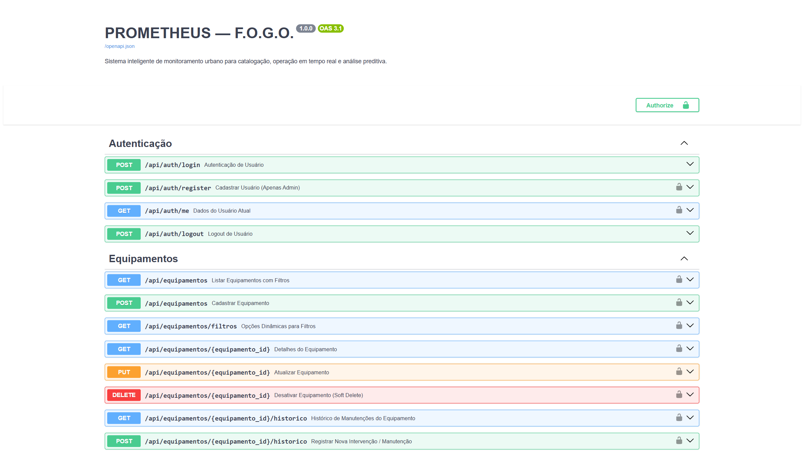

*Figura 5.1: Interface interativa do Swagger UI com documentação de todos os contratos, parâmetros e modelos de resposta.*

Todos os endpoints possuem validação rigorosa de schemas Pydantic, garantindo tipagem forte, documentação automática dos campos e sanitização contra ataques de injeção.

---

## 6. Roteiro de Validação e Testes Automatizados (43 Testes)

O PROMETHEUS possui uma suíte robusta com **43 testes automatizados** baseada em `unittest`, cobrindo tanto as regras de domínio internas quanto a integração HTTP real dos endpoints:

```powershell
docker exec prometheus-app python -m unittest discover tests
```

### Resultado de Execução dos Testes:
```text
...........................................
----------------------------------------------------------------------
Ran 43 tests in 5.116s

OK
```

### O que os testes cobrem em detalhes:
1. **`tests/test_auth.py` (6 testes — Autenticação & Segurança):**
   - Criação de novos operadores com sanitização de campos e hash seguro Bcrypt.
   - Bloqueio de e-mails duplicados com retorno HTTP 400.
   - Autenticação e emissão de tokens JWT com verificação de claims (`sub`, `email`, `tipo`).
   - Bloqueio rigoroso de senhas incorretas (HTTP 401) e de usuários inativos (HTTP 403).
2. **`tests/test_equipamentos.py` (6 testes — Gestão de Ativos):**
   - Cadastro de equipamentos urbanos com integridade e geração automática do histórico inicial.
   - Validação de coordenadas GPS em limites globais válidos (-90 a 90 latitude, -180 a 180 longitude).
   - Bloqueio de duplicidade no número de série.
   - **Regra de Negócio Automática**: ativação de `manutencao_tipo = imediata` quando a situação é `mau_funcionamento`.
   - Filtros de listagem combinados e *soft delete* (inativação lógica sem perda de histórico).
3. **`tests/test_agentes.py` (6 testes — Equipes em Campo):**
   - Cadastro de agentes de Trânsito, Guarda Municipal e PM com geolocalização.
   - Bloqueio de matrículas funcionais duplicadas.
   - Atualização de status operacional (em atividade, fora de serviço) e telefones de contato.
   - Busca textual por nome e inativação lógica (*soft delete*).
4. **`tests/test_dashboard.py` (4 testes — Central em Tempo Real):**
   - Consolidação de KPIs executivos ao vivo (total, operacionais, indisponíveis, taxa de disponibilidade).
   - Mapeamento e higienização das coordenadas geográficas para plotagem no Leaflet.js.
   - Fila de alertas prioritários ordenada por severidade.
   - Avaliação da saúde operacional e índice percentual de cada bairro de Marília.
5. **`tests/test_historico_manutencao.py` (3 testes — Histórico & Custos):**
   - Consulta e rastreabilidade cronológica de todas as mudanças de estado.
   - Registro de novas manutenções com tempo de inatividade (*downtime*) e custo financeiro em R$.
   - Registro automático no histórico gerado por transições de estado via update.
6. **`tests/test_preditivo.py` (8 testes — Inteligência Preditiva da Parte 3):**
   - Matriz de Risco Regional por Período do Dia (Manhã, Tarde, Noite, Madrugada).
   - Previsão de Falha por Confiabilidade MTBF e probabilidade percentual acumulada.
   - Geração de Alertas Preventivos baseados em limiares críticos de probabilidade.
   - Alimentação geoespacial do Mapa de Calor de Incidentes.
   - Explicabilidade da IA (XAI) com variáveis e justificativas operacionais.
   - Detecção de Zonas de Falhas Correlacionadas em infraestrutura compartilhada (raio de 300m).
   - Projeção Orçamentária de Custos de Manutenção para 30, 60 e 90 dias.
   - Fila Preditiva Ranqueada de Prioridade de Implantação (ponderação 60% risco + 40% tempo).
7. **`tests/test_api_endpoints.py` (10 testes — Integração HTTP End-to-End):**
   - Validação da disponibilidade pública da documentação Swagger (`/docs` e `/openapi.json`).
   - Autenticação HTTP via endpoint `/api/auth/login` e extração de JWT.
   - Consumo de rotas protegidas por Bearer token (`/api/auth/me`).
   - Contratos HTTP dos endpoints operacionais do Dashboard (`/metricas`, `/mapa`).
   - Listagens paginadas de `/api/equipamentos` e `/api/agentes`.
   - Contratos analíticos da Cidade Preditiva (`/resumo`, `/risco-regioes`, `/custo-projecao`).

---

## 7. Postman Collection Automatizada da API

Para facilitar a exploração, homologação e demonstração prática de toda a arquitetura de endpoints do PROMETHEUS, o projeto acompanha uma coleção no formato **Postman Collection v2.1.0**:

📁 **Localização:** [`PROMETHEUS_API.postman_collection.json`]

### Recursos de Automação Implementados na Collection:
* **Autenticação Automática e Captura do Token JWT:** Ao disparar a requisição `1. Autenticação & Sessão > Login`, um script de teste (*Post-response Script*) extrai o `access_token` retornado e o injeta na variável global `{{token}}`. Todos os endpoints protegidos das outras pastas herdam a autenticação `Bearer {{token}}` sem necessidade de configurações manuais.
* **Encadeamento Dinâmico de Identificadores:** A criação de equipamentos (`POST /api/equipamentos`) e agentes salva os IDs nas variáveis `{{createdEquipamentoId}}` e `{{createdAgenteId}}`, tornando os fluxos subsequentes de busca detalhada, atualização cadastral, inserção de histórico e exclusão completamente encadeados.
* **Testes e Asserções em Lote:** Cada endpoint conta com asserções automatizadas que validam o status code esperado (`200 OK`, `201 Created`), tempo de resposta (< 2000ms) e integridade dos schemas retornados.
* **Compatibilidade Universal:** Pode ser executada no **Postman**, **Insomnia**, **Bruno**, **Thunder Client** ou em linhas de comando / pipelines CI/CD via **Newman**:
  ```powershell
  npx newman run PROMETHEUS_API.postman_collection.json
  ```

---

## 🏁 Conclusão

O **PROMETHEUS (F.O.G.O.)** integra com excelência as três dimensões do desafio urbano:
1. **Catalogar com precisão e flexibilidade** (Inventário inteligente com atributos dinâmicos);
2. **Monitorar ao vivo com clareza operacional** (Central de operações com mapas, KPIs e alertas críticos);
3. **Antecipar o amanhã com utilidade prática** (Cidade preditiva com modelos estatísticos transparentes, explicáveis e acionáveis).
